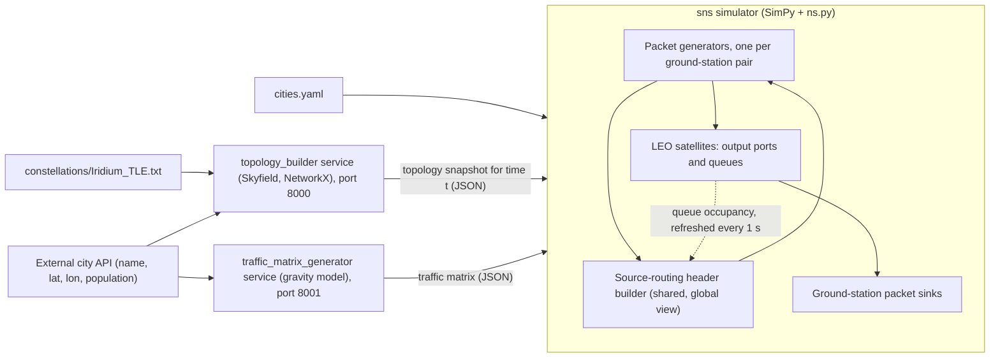

# satellite_routing

[](https://github.com/Fede-Berga/satellite_routing/actions/workflows/ci.yml)
[](LICENSE)
[](https://www.python.org/)

Simulation code for the M.Sc. thesis "A Simulation Study of Source Routing for Load Balancing in Software-Defined Satellite Networks" (University of Milano-Bicocca, 2024; supervisor Prof. Marco Savi, co-supervisor Nicola Di Cicco).

## Problem and approach

In a low Earth orbit (LEO) constellation, inter-satellite links are torn down and rebuilt as satellites move, and ground stations hand over from one satellite to the next. This project studies whether a ground-side, logically centralised controller can spread the load by computing the whole path of each packet (source routing) from a global view of link lengths and queue occupancy, and what happens to packets whose precomputed path no longer exists when they reach a satellite.

The constellation is a synthetic Iridium-like configuration of 66 satellites (11 polar planes of 6 satellites) loaded from an STK-generated TLE file. Satellite positions are propagated with [Skyfield](https://rhodesmill.org/skyfield/), the topology is a [NetworkX](https://networkx.org/) graph, and packet-level behaviour is a discrete-event simulation built on [SimPy](https://simpy.readthedocs.io/) through the [ns.py](https://github.com/TL-System/ns.py) port and wire models.

## Architecture

The repository holds three Python components. Two are Flask services; the third, `sns`, is the simulator that queries them.



- **`topology_builder/`** builds the network graph at a given instant. Each satellite links to its two intra-plane neighbours and to the closest satellite in the next plane that is in line of sight (`MinimumDistanceTopologyBuilder`); each ground station links to the closest satellite above its horizon. `LOSTopologyBuilder` is a variant that keeps the previous inter-plane neighbour and ground-station satellite while they remain visible. The builders are exposed as a Typer CLI (`python -m topology_builder`) and as a Flask endpoint, `GET /topology_builder/min_dist_topo_builder/<name>?t=...&cities=...`.
- **`traffic_matrix_generator/`** serves `GET /traffic_matrix?cities=...&total_volume_of_traffic=...`. Demand between two cities is proportional to the product of their population shares (a gravity model without the distance term).
- **`sns/`** runs the simulation in 1-second snapshots. For each snapshot it fetches the topology, rebuilds the satellite network while keeping existing ports and queues, and advances the SimPy clock by one second. A link that did not exist in the previous snapshot adds a 0.1 s switching delay before its first packet.

Routing happens in `sns/sns/sr_header_builder.py`. A single header-builder instance, shared by every packet generator, plays the role of the SDN controller: it copies the current graph, assigns a weight to each link and writes the full list of output ports and next hops into each packet. Its view is refreshed at most once per second, and refreshes requested by the generators take effect after a fixed 0.35 s control delay (`LEO_GEO_GS_TD`). Four builders are implemented:

| Builder | Link weight / path choice |
| --- | --- |
| `BaselineSourceRoutingHeaderBuilder` | Shortest path by link length (km) |
| `NoSmoothingOnBufferSizeSourceRoutingHeaderBuilder` | Length + `1 / (1 - occupancy / queue size)`, from the latest queue sample |
| `ExponentialSmoothingOnBufferSizeSourceRoutingHeaderBuilder` | Same, with queue occupancy smoothed by an exponential moving average (alpha = 0.125) |
| `KShortestNodeDisjointSourceRoutingHeaderBuilder` | Node-disjoint paths between the access satellites, one picked at random per packet with probability decreasing in its weight |

Satellites forward with one of two strategies (`sns/sns/leo_satellite.py`). With **port forwarding** a satellite sends the packet out of the port named in the header, even if that port now leads to a different neighbour. With **early discarding** it first checks that the next hop named in the header is still one of its neighbours and drops the packet otherwise. Fixed parameters (1500-byte packets, 1 Gbit/s ports, 10,000-packet queues, 10 GB/s total offered load) are in `sns/sns/network_parameters.py`.

## Quick start

Prerequisites: [uv](https://docs.astral.sh/uv/), which also installs Python 3.12. Each component pins its dependencies (from 2023) in its own `requirements.txt`.

### Build a topology snapshot (no services needed)

```sh
cd topology_builder
mkdir -p results
uv run --python 3.12 --with-requirements requirements.txt --with typer --with pyyaml \
  python -m topology_builder build-single-topology --config-file config.yaml
```

This reads [`topology_builder/config.yaml`](topology_builder/config.yaml) (constellation file, nine ground stations, time `t`) and writes the graph as node-link JSON to `results/iridium_static_status.json`. `typer` and `pyyaml` are needed by the CLI but are not listed in `requirements.txt`.

### Run the packet-level simulation

The simulator needs both services. They resolve city names through an external HTTP API that is not part of this repository: `GET <BASE_CITY_API_URL>?name=<city>` with an `X-Api-Key` header, returning a JSON list whose first element has `name`, `latitude`, `longitude` and `population`. To start the services with Docker Compose, create the files that [`docker-compose.yaml`](docker-compose.yaml) expects (all are gitignored):

- `city_api_key.txt` in the repository root, containing the API key;
- `topology_builder/.env` and `traffic_matrix_generator/.env`, each setting `BASE_CITY_API_URL`.

Then run `docker compose up --build` and, in another shell:

```sh
cd sns
uv run --python 3.12 --with-requirements requirements.txt --with 'setuptools<81' \
  python analytics/analytics.py
```

`setuptools<81` is required because the pinned SimPy 4.0.2 imports `pkg_resources`. The script simulates 30 seconds from 2023-09-12 10:00 UTC with the node-disjoint builder, once per forwarding strategy, for the 11 cities in [`cities.yaml`](cities.yaml).

Optionally, compile four of the simulator modules with Cython (needs a C compiler):

```sh
cd sns
uv run --python 3.12 --with-requirements requirements.txt --with 'setuptools<81' \
  python cython_setup_sns.py build_ext --inplace
```

`setup_ns.py` and `setup_simpy.py` do the same for ns.py and SimPy and must be copied into those projects' source trees.

## Output

The repository contains no result data. `sns/analytics/analytics.py` prints, for each forwarding strategy, the packets sent, dropped and delivered, and the share of drops caused by stale routes versus full queues; `Network.dump_status()` prints per-satellite and per-port counters after every snapshot. The plotting code in that script is commented out.

The scripts in `topology_builder/analisys/` sweep one hour at 1 s steps with both topology builders and save Matplotlib figures under `images/`: topology stability intervals, average link length, link changes per step, and the duration, length and hop count of the best path between ground stations. They also need `pyyaml` (and `mdutils` for `best_path_analitics.py`), which are not in `requirements.txt`.

## Running the tests

The topology builder has a pytest suite. It uses paths relative to the `tests` directory:

```sh
cd topology_builder/tests
uv run --python 3.12 --with-requirements ../requirements.txt --with pytest --with pytz pytest
```

CI runs this suite on every push and pull request. The tests in `sns/test/` are not run: they need both services and a city API key, and `test_sns.py` calls `run_sns_simulation` with an outdated signature.

## Limitations

- This is research code written for a thesis, not a library. Parameters are constants in the source, paths are relative to specific working directories, and several identifiers keep their original spelling (`analisys`, `GROUD_STATION`).
- Satellite names and plane assignment are generated in code for exactly 66 satellites in 11 planes; other constellations need a new repository class.
- The simulation depends on a third-party city API for ground-station coordinates and populations, so it cannot be run offline as is.
- `build-dynamic-topology` in the CLI builds every step at the fixed time `t` from the config instead of the current step time.
- Both Dockerfiles use `python:latest`, while the pinned dependencies date from 2023 and were checked here with Python 3.12 only.
- Traffic is constant bit rate per ground-station pair, and the gravity model ignores distance.

## Citation

Citation metadata, including the thesis reference, are in [`CITATION.cff`](CITATION.cff).

## License

[MIT](LICENSE)
